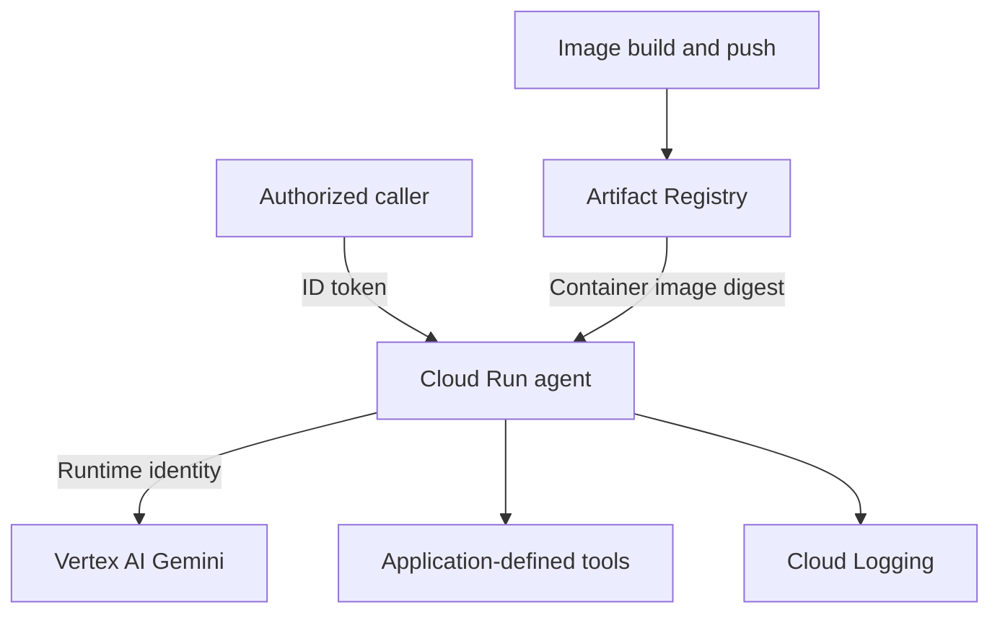

# Modular serverless agent deployment on Google Cloud

Reference infrastructure for an existing containerized agent (ADK or another framework).
Cloud Run executes agent orchestration and tool calls. Gemini inference is consumed
through Vertex AI: this configuration does not train, upload or self-host model weights.
It does not implement an agent, tools, RAG, durable memory or an evaluation pipeline.

## Module dissection

| Module | Responsibility | Why separate it |
|---|---|---|
| apis | Enable required Google APIs; retain them on destroy | Project prerequisites are explicit |
| identity | Dedicated runtime identity and Vertex AI User grant | Separate runtime permissions from deployment permissions |
| registry | Docker Artifact Registry repository with immutable tags | Separate image production from infrastructure deployment |
| agent | Cloud Run v2, runtime settings, explicit invoker grants | Independently review runtime and access configuration |

The root composes dependencies. IAM bindings are additive. No service-account keys
are created. The runtime authenticates through Application Default Credentials.
The deployer and the caller are separate identities from the runtime.

## Request and deployment flow



Tools are application-level integrations, not resources provisioned by this example.
Cloud Run collects stdout/stderr and platform metrics; custom traces, alerts and
agent-specific metrics must be added. Avoid logging sensitive prompts or tool results.

## Prerequisites

- Existing billed Google Cloud project; Terraform 1.5+ and gcloud; Docker for image builds.
- Enable Service Usage API through your project bootstrap if it is not already enabled.
- Deployment principal needs API enablement, service-account creation, project IAM
  membership management, Artifact Registry management and Cloud Run management,
  plus iam.serviceAccounts.actAs on the runtime identity. Have an administrator
  scope these permissions; they are deliberately not granted to the runtime.
- Image publisher needs repository write access. Cloud Run's service agent needs
  image-read access (normally supplied in the same project); cross-project images
  need explicit repository access for the destination Cloud Run service agent.
- Choose a Gemini model available in your selected Vertex AI location and project.
  Setting a region alone is not a full data residency guarantee.

## Deploy in two deliberate phases

```bash
gcloud auth application-default login
cp terraform.tfvars.example terraform.tfvars
# Edit project_id, region and vertex_location. Keep deploy_agent=false.
terraform init
terraform fmt -check -recursive
terraform validate
terraform plan -out=foundation.tfplan
terraform apply foundation.tfplan
terraform output -raw repository_url
```

Build your actual agent application and push a unique release tag to the repository:

```bash
# Replace these values using your repository output and application path.
gcloud auth configure-docker us-central1-docker.pkg.dev
docker build --platform linux/amd64 -t us-central1-docker.pkg.dev/PROJECT/agent-runtime/agent:release-001 /path/to/agent
docker push us-central1-docker.pkg.dev/PROJECT/agent-runtime/agent:release-001
```

Copy the pushed sha256 digest. Edit terraform.tfvars:
- deploy_agent = true
- agent_image = "us-central1-docker.pkg.dev/PROJECT/agent-runtime/agent@sha256:ACTUAL_64_CHARACTER_DIGEST"
- model_id = "YOUR_SUPPORTED_MODEL_ID"
- invoker_members = ["serviceAccount:YOUR_CALLER@PROJECT.iam.gserviceaccount.com"]

```bash
terraform plan -out=runtime.tfplan
terraform apply runtime.tfplan
terraform output -raw agent_url
```

In CI, prefer Workload Identity Federation. Commit the generated .terraform.lock.hcl.
Use a separately bootstrapped GCS state backend with restricted IAM and versioning
for team use; the starter uses local state. Never commit state or saved plans.

## Application contract

- Listen on 0.0.0.0:$PORT (8080); provide your own HTTP routes and validation.
- Use Vertex AI via ADC; read GOOGLE_CLOUD_PROJECT, GOOGLE_CLOUD_LOCATION and
  GOOGLE_GENAI_USE_VERTEXAI. MODEL_ID is a convention in this example: your code
  must explicitly read it and pass it to the agent/model constructor.
- Keep execution inside the request lifecycle. Request-based CPU is not suitable
  for fire-and-forget work after a response. Use Tasks/Workflows/Jobs for durable
  long-running work; those resources are not included here.
- Store sessions externally if required. Cloud Run memory/filesystem are ephemeral;
  in-memory ADK sessions do not provide reliable multi-instance conversations.
- Apply tool allowlists, argument validation, iteration/token budgets, retries with
  backoff, idempotency and explicit approval for consequential tool actions in code.

## Authentication smoke test

A service-account caller needs roles/run.invoker on this service. To test by
impersonation, your operator also needs permission to mint tokens for that caller:

```bash
AGENT_URL=$(terraform output -raw agent_url)
TOKEN=$(gcloud auth print-identity-token --impersonate-service-account=YOUR_CALLER@PROJECT.iam.gserviceaccount.com --audiences="$AGENT_URL")
curl --fail-with-body -H "Authorization: Bearer $TOKEN" "$AGENT_URL/YOUR_HEALTH_ROUTE"
```

Use your application's real route. The same request without a valid token should
be denied. Confirm inherited project/folder IAM has not granted wider invocation.

## Design limits and production decisions

The HTTPS endpoint is internet-routable but IAM-authenticated: it is not a private
VPC endpoint. Organization policies may require a different ingress design.
Concurrency 8, 1 vCPU, 1 GiB and 5 maximum instances are starting values, not
benchmarks. Load-test them with actual model latency and tool behavior. Scale-to-zero
may add cold-start latency. Instance limits are not a strict token-spend cap and
platform behavior can temporarily exceed configured limits. Add application rate
limits, token budgets, quota monitoring and billing alerts.

roles/aiplatform.user is convenient but broader than inference-only access; review
a custom role for the precise APIs your agent invokes. Tool permissions are not
granted automatically. Use Secret Manager references and scoped IAM if external
tool credentials are needed; do not put secret values in Terraform variables/state.

Before production, add workload-specific evaluations, tool authorization, durable
session storage if needed, alerting, audit policies and a tested rollback process.
This repository is a deployment foundation, not a claim of production readiness.

## Cleanup

Deletion protection defaults to true. To remove the service, set it to false and
apply that change before terraform destroy. Destroy also removes the managed image
repository and its images; preserve releases first. APIs remain enabled. Local state
and external resources are not cleaned up by this repository.

## Sources

- https://docs.cloud.google.com/run/docs/quickstarts/build-and-deploy/deploy-python-adk-service
- https://docs.cloud.google.com/run/docs/ai/authenticate-agents
- https://registry.terraform.io/providers/hashicorp/google/7.18.0/docs/resources/cloud_run_v2_service
- https://docs.cloud.google.com/run/docs/configuring/concurrency

## Verification

See VALIDATION.md for checks actually performed. No cloud resources were deployed.
